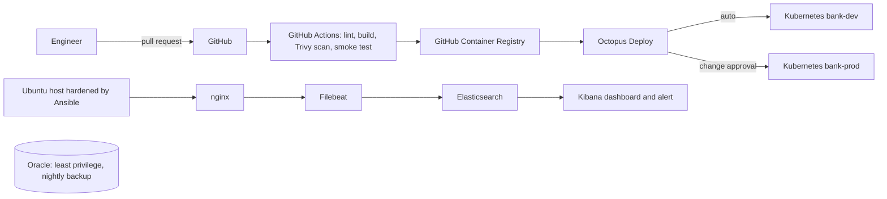

# Bank SRE Platform Lab

A self-directed, small-scale lab of how a bank could build, secure, release and run a customer-facing service. Built by Shravani Uthaman to get hands-on with GitHub Actions, Ansible, Kubernetes, Octopus Deploy, Oracle administration and Elastic, building on the Docker, Jenkins, Git and Oracle work I did at MetricStream. Demo data only; nothing here is production.

## Architecture



## What is in here

| Folder | What it does |
|---|---|
| `app/`, `Dockerfile` | Demo balance service (nginx) with a `/health.json` endpoint and a container health check |
| `.github/workflows/ci.yml` | CI: lint scripts, build the image, Trivy CVE scan (fails on critical), smoke test, publish to GitHub Container Registry |
| `scripts/` | Bash and PowerShell health and URL checks; nightly Oracle backup script |
| `ansible/` | Host hardening: patching, automatic security updates, named admin user, SSH (no root, keys only), deny-by-default firewall, login banner, nginx front end |
| `k8s/` | Kubernetes deployment: 2 replicas, readiness and liveness probes, resource limits, rolling updates, Dev and Prod namespaces (AKS-ready YAML) |
| `octopus/` | Octopus Deploy setup: Dev to Prod lifecycle, change approval, deploy and smoke-test scripts, health-check runbook |
| `oracle/` | Least-privilege users and roles, demo table, daily health queries, Data Pump backup and restore |
| `observability/` | Elasticsearch, Kibana and Filebeat for nginx logs; dashboard and an alert on 502 errors |
| `SECURITY.md` | Vulnerability management: find, assess, prioritise, fix, verify |

## Quick start

```bash
docker build -t balance-service:local .
docker run -d --name balance -p 8080:80 balance-service:local
./scripts/health_check.sh            # HTTP 200, disk usage, "All checks passed"
```

## Lab run log

I am working through the lab module by module and tick each item once I have run it and checked the result.

- [x] Built the service image locally and checked `/health.json` returns HTTP 200 and the container reports healthy
- [x] Bash health check that exits with a failure code when the service is down
- [ ] CI pipeline green on GitHub Actions, and a deliberately failing run fixed
- [ ] Trivy: old nginx image with high and critical CVEs compared with the current image
- [ ] Ansible playbook run twice to show `changed=0` (idempotent)
- [ ] Kubernetes: self-healing pod, scaling, bad image release rolled back with no outage
- [ ] Octopus: release promoted Dev to Prod through the change-approval step
- [ ] Oracle: read-only user blocked from deleting (ORA-01031); table dropped and restored from backup
- [ ] Kibana alert fires when the service is stopped

## Lab limits, and what I would do in production

- Run on **AKS** with Entra ID for cluster access, and Azure Monitor alongside Elastic
- Keep all secrets in **Azure Key Vault** or **CyberArk**, never in files (lab passwords here are throwaway placeholders)
- Turn on **Elastic security** (TLS and users), which is off in this lab for simplicity
- **RMAN** physical backups in ARCHIVELOG mode for point-in-time recovery, copied off-site
- **Terraform** for the infrastructure, and Octopus Kubernetes targets instead of a laptop Tentacle
- Link every Prod approval to a change ticket, and keep audit logs centrally
- Some firewall, SSH and audit settings are limited inside WSL; they apply fully on a real VM

## Screenshots

See [`docs/`](docs/).
